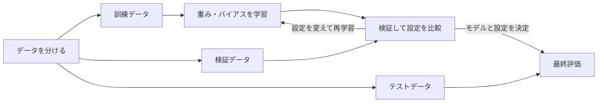
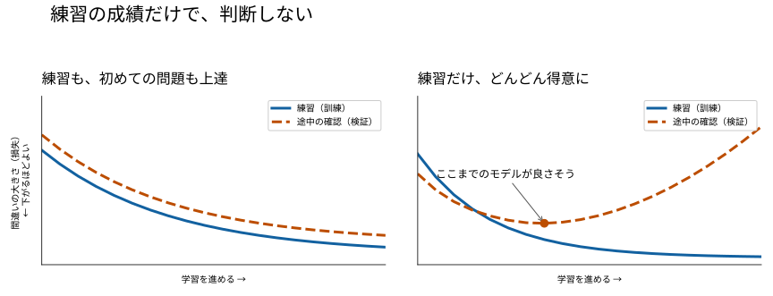
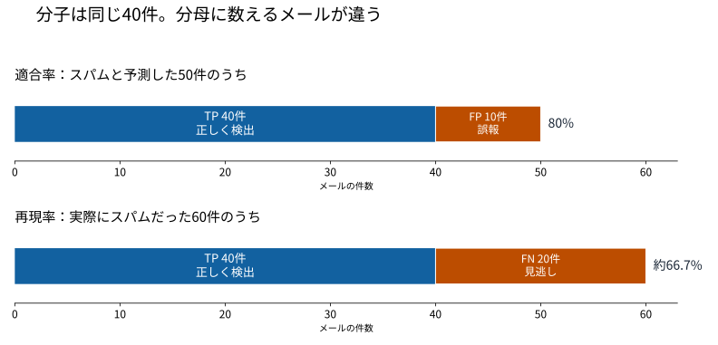

# 第4章：学習の評価とチューニング - 「そこそこ動く」を越える

第3章では損失を計算し、勾配を使って重み・バイアスを更新する仕組みを学びました。次に確かめたいのは、**学習に使っていないデータにも、うまく予測できるか**です。この能力を汎化性能（generalization）と呼びます。

たとえば、手書き数字を分類するモデルが、練習に使った画像ではほぼ全問正解したとします。それだけで、別の人が書いた数字も読めると判断してよいでしょうか。未知の画像で成績を確かめ、うまくいかない原因に合わせて調整する必要があります。

この章を読み終えたときの目標は、次の3つです。

- 訓練損失と検証損失を見て、学習の状態と次に試す対策を説明できる。
- 混同行列から、見逃しと誤報を区別して評価できる。
- テストデータを調整に使わず、設定を比較する手順を組み立てられる。

第1章のデータ分割を、先に思い出しておきましょう。訓練データは重みを学ぶため、検証データは設定や学習を止める時点を選ぶため、テストデータは選び終えたモデルの性能を報告するために使います。



検証結果を見ながら設定を調整する、この往復がチューニングです。テストデータはこの往復に入れません。

> 講義の進め方の目安：導入5分、4.1を10分、4.2を15分、4.3を10分、4.4を5分、演習・質疑を15分。折りたたんだ補足やコードの細部は、復習にも使えます。

## 4.1 過学習と未学習

### 訓練と検証の成績を比べる

過去問を繰り返し解く場面で考えてみます。解き方を理解できれば、初めての問題にも対応できます。一方、問題と答えの組だけを覚えてしまうと、過去問では満点でも、初めての問題では成績が落ちます。後者が過学習のイメージです。

モデルでも、訓練データに合わせすぎると、そのデータに偶然含まれていた特徴や、測定の誤差などのノイズまで学んでしまいます。この状態を過学習（overfitting）と呼びます。訓練データの特徴を十分に捉えられていない状態は、未学習（underfitting）です。

| 状態 | 訓練データでの損失 | 検証データでの損失 | まず考えること |
|---|---|---|---|
| 未学習 | 大きい | 大きい | 学習が進んでいるか。学習率やモデルの大きさは適切か |
| うまく学習できている | 小さい | 小さい | 目的に合う評価指標でも十分な成績か |
| 過学習 | 小さい | 訓練に比べて大きい | 学習を続けすぎていないか。正則化やデータ追加が必要か |

損失の「大きい・小さい」に、すべての問題で共通する境目はありません。同じデータ分割・同じ損失関数で、学習前の値や比較用のモデルと比べます。

また、訓練と検証の差には、データの性質の違いも影響します。たとえば訓練画像は明るく、検証画像は暗いものばかりなら、差の原因は過学習だけとは限りません。グラフとともに、実際のデータや間違えた例も確認します。

### 学習曲線は、2本の線を一緒に読む

第3章のエポックは訓練データ全体を1周する単位でした。エポックごとの訓練損失と検証損失を線で表すと、学習がどのように進んだかを確認できます。これを学習曲線（learning curve）と呼びます。



*図1：読み方を説明するための模式図です。実際の学習結果ではありません。青の実線が訓練損失、オレンジの破線が検証損失です。*

| 図の状態 | 読み取れること | 次に確かめること・試すこと |
|---|---|---|
| A：両方が下がっている | 検証での予測も改善している | 学習を続け、改善が続くかを見る |
| B：訓練は下がるが、検証は途中から上がる | 過学習の兆候がある | 検証損失が最小だった時点を使う。正則化も検討する |
| C：両方が高いまま | 十分に学習できていない | 入力・ラベル・学習処理を確認し、学習率やモデルを調整する |
| D：大きく上下する | 学習が不安定になっている可能性がある | 学習率が大きすぎないか、外れ値や前処理に問題がないか調べる |

図Bで採用したいのは、訓練損失が最も低い最後のモデルではなく、検証損失が最も低い時点のモデルです。4.2の早期終了ではその時点の重みを保存しておきます。

4.2で扱うドロップアウトやデータ拡張では、訓練時だけ一部の出力を使えなくしたり、入力を変化させたりします。訓練のほうが難しい条件になるため、検証損失が訓練損失より低くても、すぐに異常とは判断できません。比較するときは、両者の計算条件も確認します。

### バイアスとバリアンスで原因を整理する

学習の状態を考えるために、バイアスとバリアンスという言葉も押さえておきましょう。

| 用語 | 意味 | イメージ |
|---|---|---|
| バイアス（bias） | モデルの仮定などによる、系統的な予測のずれ | 曲線の関係を直線だけで表そうとして、どのデータでもずれる |
| バリアンス（variance） | 訓練データの選ばれ方による、予測の変わりやすさ | 少しデータが変わるだけで、予測の形が大きく変わる |

ここでのバイアスは第2章の式に出てきたパラメータ $b$ とは別の意味です。

単純すぎるモデルではバイアスが大きくなりやすく、少ないデータに複雑なモデルを合わせるとバリアンスが大きくなりやすくなります。これが、バイアスとバリアンスのトレードオフという考え方です。

ただし、深層学習でモデルを大きくすると必ず検証性能が下がる、という法則ではありません。データ量や正則化、学習方法も結果に関わるため、実際の検証結果で判断します。

<details>
<summary>補足：誤差はバイアスとバリアンスだけで決まる？</summary>

二乗誤差を一定の仮定のもとで分解すると、バイアスの二乗とバリアンスに加えて、観測に含まれるノイズの項も現れます。ここでは厳密な分解式を覚えるよりも、「表現が単純すぎるのか」「訓練データへの依存が強すぎるのか」を考える視点として使います。

</details>

## 4.2 汎化性能を上げる手法

### データ分割と交差検証

対策の効果を判断するには、評価に使うデータを適切に分けておく必要があります。

| 分割 | 役割 | 結果を何に使うか |
|---|---|---|
| 訓練データ（train） | 重み・バイアスを学ぶ | 勾配を計算してパラメータを更新する |
| 検証データ（validation） | モデルや設定を比較する | 学習率、正則化の強さ、終了時点などを選ぶ |
| テストデータ（test） | 選定を終えたモデルを評価する | 未知のデータに対する性能を報告する |

たとえば、独立した画像が1,000枚あれば、訓練700枚・検証150枚・テスト150枚に分ける方法があります。この比率は説明用の例です。実際にはデータ量やクラスごとの件数に合わせて決めます。

テスト結果を見て学習率を変え、良くなるまで試すと、テストデータも設定の選定に使ったことになります。そのスコアを、未知のデータへの公平な評価として扱えなくなります。**調整には検証データを使い、テストデータは調整を終えてから評価に使います**。

検証データにも、何度も設定を合わせれば過学習する可能性があります。最後まで別のテストデータを残すのは、この偏りも含めて確認するためです。

#### 「別の行」でも、独立したデータとは限らない

同じ人の画像や、同じ写真を加工した画像が訓練と検証に分かれると、未知のデータへの性能を高く見積もることがあります。評価に使う情報が学習や設定選びに入り込むことをデータリークと呼びます。

| データの性質 | 分割・前処理で気をつけること |
|---|---|
| 同じ患者・利用者・製品のデータが複数ある | 新しい対象への予測を評価するなら、同じ対象を別の分割に混ぜない |
| 時系列データで未来を予測する | 過去で学習し、それより後の期間で検証・テストする |
| 平均・標準偏差などをデータから求める | 訓練データだけで求め、検証・テストにも同じ値を使う |
| 画像を回転・加工して増やす | 元の画像を分割してから、訓練側だけを拡張する |

データが少なく、1回の分割による結果の偏りが気になる場合は、k-分割交差検証（k-fold cross validation）も選択肢です。テスト用を除いたデータをk個に分け、検証に使う部分を入れ替えながらk回学習します。

```text
5分割の例（検＝検証、訓＝訓練）

          分割1  分割2  分割3  分割4  分割5
1回目       検     訓     訓     訓     訓
2回目       訓     検     訓     訓     訓
3回目       訓     訓     検     訓     訓
4回目       訓     訓     訓     検     訓
5回目       訓     訓     訓     訓     検

各回の検証スコアを集め、平均とばらつきを確認する
テストデータはこの5分割には含めない
```

各回ではモデルを初期化し、前処理もその回の訓練データで学び直します。時系列や同じ人のデータには、その性質に合う分割が必要です。深層学習では学習時間が長くなるため、訓練・検証を一度分けるホールドアウト法を使うことも多くあります。

### 対策は、学習曲線の状態に合わせて選ぶ

過学習を抑える方法をまとめて正則化（regularization）と呼びます。重みに制約を加える方法のほか、ドロップアウトや早期終了も含まれます。すべてを一度に加えると、どの対策が役立ったか分かりにくくなります。

| 方法 | 何を変えるか | 主に確かめたいこと |
|---|---|---|
| L1・L2正則化、weight decay | 重みの大きさに制約を加える | 検証損失が改善するか。制約が強すぎないか |
| ドロップアウト | 学習時に一部の出力をランダムに0にする | 特定の出力への依存を減らせるか |
| 早期終了 | 検証結果に基づいて学習を止める | 学習を続けすぎていないか |
| データ拡張 | 正解を保つ変換を加えたデータでも学ぶ | 位置や明るさなどの変化に対応できるか |
| バッチ正規化 | 層の途中の値を正規化する | 学習が安定するか。主目的は学習の安定化 |

### L1・L2正則化：重みの大きさにも目を向ける

第3章では予測と正解のずれを損失にしました。L1・L2正則化ではその損失に重みの大きさに応じたペナルティを加えます。

$$
L_{\mathrm{L2}} = L_{\mathrm{data}} + \lambda \sum_i w_i^2
$$

$$
L_{\mathrm{L1}} = L_{\mathrm{data}} + \lambda \sum_i |w_i|
$$

$L_{\mathrm{data}}$ は予測のずれ、$w_i$ は各重み、$\lambda$（ラムダ）はペナルティの強さです。L2は大きな重みに強いペナルティを与えます。L1は重みを0に近づけ、一部を0にする性質があります。ただし、通常の勾配法で学習した値が、必ずちょうど0になるとは限りません。

たとえば、重みが `[1, 1]` と `[2, 0]` の場合、二乗の合計はそれぞれ2と4です。予測の損失が同じなら、L2正則化は前者を選ぶ方向に働きます。

ペナルティを強くすると、訓練データへの合わせすぎを抑えられる一方、必要な特徴まで学びにくくなることがあります。$\lambda$ も検証データで調整します。

<details>
<summary>コードで確認：weight decayとL2の関係</summary>

weight decayは更新時に重みを小さくする仕組みです。単純なSGDでは、係数の定義をそろえるとL2正則化と同じ更新になります。一方、AdamWは損失にL2項を足す操作とは分けて重みを減衰させます。すべての最適化手法で「weight decay＝L2の係数」と考えないようにします。

次は定義済みの `model` にAdamWを設定する例です。

```python
import torch

optimizer = torch.optim.AdamW(
    model.parameters(), lr=1e-3, weight_decay=1e-4
)
```

L1項を自分で足す場合は、次のように書けます。`output` と `target` は予測と正解、`criterion` は第3章の損失関数です。この例では、2次元以上のパラメータを重みとして対象にしています。

```python
l1 = sum(p.abs().sum() for p in model.parameters() if p.ndim >= 2)
loss = criterion(output, target) + 1e-5 * l1
```

</details>

### ドロップアウト：一部の出力だけに頼りすぎない

学習中に、一部のニューロンの出力をランダムに0にするのがドロップアウト（dropout）です。毎回違う出力が使えなくなるため、特定の出力への依存を減らす効果が期待できます。層や重みは残したまま、出力だけを変えます。

```text
ある層の出力       [ 0.8, 0.4, 0.6, 0.2 ]
残すかどうか       [   1,   0,   1,   0 ]  ← この回の例
Dropoutの出力      [ 1.6,   0, 1.2,   0 ]
```

PyTorchの `nn.Dropout(p=0.5)` は、各要素を50%の確率で0にします。毎回ちょうど半分になるとは限りません。残った値は `1 / (1 - p)` 倍され、出力の期待値を保ちます。上の例では2倍です。

第2章の全結合ネットワークに加えると、次のようになります。入力は28×28画素を1列にした784個の数値です。出力は0〜9の10クラスに対する生のスコア（logits）です。

```python
import torch.nn as nn

model = nn.Sequential(
    nn.Linear(784, 256),
    nn.ReLU(),
    nn.Dropout(p=0.5),
    nn.Linear(256, 10),
)
```

第3章の `nn.CrossEntropyLoss()` を使う場合は、この出力にSoftmaxを重ねず、そのまま渡します。

**評価の前には `model.eval()`、学習に戻るときには `model.train()` を呼びます**。 `torch.no_grad()` は勾配の記録を止める機能で、評価モードへの切り替えとは役割が違います。

| 操作 | Dropoutの動作 | 勾配の記録 |
|---|---|---|
| `model.train()` | ランダムに出力を0にする | この呼び出し自体では切り替えない |
| `model.eval()` | 出力をそのまま通す | この呼び出し自体では切り替えない |
| `torch.no_grad()` の中 | 現在のモードのまま | 記録しない |

### 早期終了：検証が良かった時点の重みを使う

検証損失が改善しなくなったら学習を止める方法が、早期終了（Early Stopping）です。図1のBのように、学習を続けるほど検証性能が悪くなる場合に役立ちます。

実際の検証損失は少しずつ上下するため、1回悪くなっただけでは止めず、数エポック待つことがあります。この待つ長さが `patience` です。

```text
エポック          1     2     3     4     5     6
検証損失        0.80  0.60  0.50  0.52  0.54  0.55
最良値の更新      ○     ○     ○     ×     ×     ×
改善しない回数    0     0     0     1     2     3
```

`patience=3` なら、この例では6エポック目で止めます。**使うのは最後の重みではなく、検証損失が最小だった3エポック目の重みです**。

<details>
<summary>コードで確認：評価モードへの切り替えと、最良の重みの復元</summary>

次は第3章の学習ループに検証を加えた例です。`model` は上のモデル、`train_loader` と `val_loader` は訓練用・検証用のDataLoaderとします。どちらも `[バッチ件数, 784]` の入力と、0〜9の整数ラベルを返す前提です。DataLoaderの準備と実データでの実行は第9章で扱います。

```python
import copy
import torch
import torch.nn as nn

# モデルと入力を同じデバイスへ移す
device = torch.device("cuda" if torch.cuda.is_available() else "cpu")
model = model.to(device)
criterion = nn.CrossEntropyLoss()
optimizer = torch.optim.AdamW(model.parameters(), lr=1e-3, weight_decay=1e-4)


def train_one_epoch(model, loader):
    model.train()  # 前のエポックの評価モードから戻す
    for x, y in loader:
        x, y = x.to(device), y.to(device)
        optimizer.zero_grad()
        loss = criterion(model(x), y)
        loss.backward()
        optimizer.step()


@torch.no_grad()
def evaluate(model, loader):
    model.eval()
    total_loss, total = 0.0, 0
    for x, y in loader:
        x, y = x.to(device), y.to(device)
        loss = criterion(model(x), y)
        # バッチ平均を件数で重み付けし、全サンプルの平均を求める
        total_loss += loss.item() * y.size(0)
        total += y.size(0)
    return total_loss / total


best_loss = float("inf")
best_state = None
patience, wait = 3, 0

for epoch in range(1, 101):
    train_one_epoch(model, train_loader)
    val_loss = evaluate(model, val_loader)

    if val_loss < best_loss:
        best_loss = val_loss
        best_state = copy.deepcopy(model.state_dict())
        wait = 0
    else:
        wait += 1
        if wait >= patience:
            break

# 学習を止めた時点ではなく、検証損失が最小だった重みに戻す
model.load_state_dict(best_state)
model.eval()
```

`state_dict()` はモデルの重みなどをまとめたものです。学習中に保存内容まで変わらないよう、`copy.deepcopy()` でコピーを残します。この例は、各DataLoaderが空でなく、損失が有限の値になる前提です。バッチ内の平均損失に件数を掛けるのは、最後のバッチだけ小さくても、各サンプルを同じ重みで平均するためです。

</details>

### データ拡張：正解を保ったまま、入力に変化を加える

画像の位置や明るさを変えた例でも学習すると、元の訓練画像だけへの合わせすぎを抑えられることがあります。既存データに変換を加えて学習する方法を、データ拡張（Data Augmentation）と呼びます。

| データ | 拡張の例 | 正解が変わらないか確認する例 |
|---|---|---|
| 画像 | 小さな回転、切り抜き、明るさ変更、左右反転 | 文字を反転して読めなくしていないか |
| テキスト | 同義語への置換、別の言語を経由して訳し直す逆翻訳 | 否定や専門用語の意味が変わっていないか |
| 音声 | 雑音の追加、速度変更、周波数の一部を隠す | 発話内容が聞き取れる範囲か |

手書き数字では、大きく回転させると6が9に見えるなど、正解の意味が変わる場合があります。拡張の種類と強さは、対象のデータに合わせます。

```python
from torchvision import transforms

# 手書き数字向けの例。小さな回転が妥当かは実際の画像で確認する
train_tf = transforms.Compose([
    transforms.RandomRotation(10),
    transforms.ToTensor(),
])
val_tf = transforms.ToTensor()
```

この例では、ランダムな回転は訓練時だけに使います。検証・テストでは同じ入力を同じ条件で比べます。数値の正規化など、必要な共通の前処理はすべての分割に適用します。

第5章のCNNでも、このデータ拡張の考え方を使います。

### バッチ正規化：層の途中の値を整える

バッチ正規化（Batch Normalization）は、ミニバッチ内の平均と分散を使って層の途中の値を正規化する方法です。その後、学習可能な係数で値の大きさと位置を調整します。したがって、最終的な出力が必ず平均0・分散1になるわけではありません。

学習が安定し、収束が速くなる場合があります。副次的に正則化の効果もありますが、主に学習を安定させる目的で使います。

```python
model_with_bn = nn.Sequential(
    nn.Linear(784, 256),
    nn.BatchNorm1d(256),
    nn.ReLU(),
    nn.Linear(256, 10),
)
```

この構成では全結合層の出力を正規化してからReLUに渡します。PyTorchの標準設定では、学習時はそのミニバッチの統計量を使い、評価時は学習中に蓄積した統計量を使います。ここでも `model.train()` と `model.eval()` の切り替えが必要です。

バッチが小さすぎると統計量が不安定になることがあります。第7章で扱うTransformerでは、別の方法であるレイヤー正規化が登場します。

## 4.3 評価指標

### 正解率99%でも、目的を果たしているとは限らない

ここからは、スパムメールの分類を例にします。メール1,000件のうち、スパムが10件、通常メールが990件だったとします。すべてを「通常」と判定すれば、正解率は99%です。それでも、スパムは1件も検出できていません。

クラスごとの件数に大きな偏りがあるデータを不均衡データと呼びます。正解率は全体の成績を表しますが、**何を、どちらに間違えたか**も見る必要があります。

### 混同行列で、誤報と見逃しを分ける

予測と実際の正解を表にまとめたものが、混同行列（confusion matrix）です。二値分類では2×2になります。ここでは、検出したい「スパム」を陽性（positive）、「通常メール」を陰性（negative）と決めます。陽性は「良い」という意味ではありません。

次の表は、1,000件中スパムが60件ある別の例です。以降の計算と演習1でも、この数値を使います。

| 実際の正解 ↓ ／ モデルの予測 → | スパムと予測 | 通常と予測 | 合計 |
|---|---:|---:|---:|
| スパム | TP = 40 | FN = 20 | 60 |
| 通常 | FP = 10 | TN = 930 | 940 |
| 合計 | 50 | 950 | 1,000 |

TP（True Positive）はスパムを正しく検出した件数、TN（True Negative）は通常メールを正しく通常と判定した件数です。FP（False Positive）は通常メールをスパム扱いした「誤報」、FN（False Negative）はスパムを通常と判定した「見逃し」です。

表は、まず行を選んでから列を読みます。「実際は通常」の行から「スパムと予測」の列を見るとFPです。ライブラリや資料によって行・列の並びが違うため、見出しを毎回確認します。

### 適合率と再現率は、分母が違う

| 指標 | 答えたい問い | 式 | 上の例 |
|---|---|---|---|
| 正解率（Accuracy） | 全体で何件正解したか | $(TP + TN) / N$ | $970 / 1000 = 97\%$ |
| 適合率（Precision） | スパムと判定したうち、実際にスパムだった割合は？ | $TP / (TP + FP)$ | $40 / 50 = 80\%$ |
| 再現率（Recall） | 実際のスパムのうち、検出できた割合は？ | $TP / (TP + FN)$ | $40 / 60 \approx 66.7\%$ |
| F1値 | 適合率と再現率の両方をまとめると？ | $2PR / (P + R)$ | 約 $72.7\%$ |

$N$ は全件数、$P$ は適合率、$R$ は再現率です。適合率は「予測がスパムだった50件」、再現率は「実際にスパムだった60件」を分母にしています。



*図2：どちらも分子はTPの40件です。分母に誤報を含めるか、見逃しを含めるかが違います。*

F1値は、適合率と再現率の調和平均です。片方だけが高くても高い値になりにくく、この表では `2 × 40 / (2 × 40 + 10 + 20)` でも計算できます。ただし、TNを式に含まず、誤報と見逃しの業務上の損失も直接表してはいません。

#### コードでは、ラベルの並びを明示する

次のコードは、10件の小さな例をそのまま実行できます。`0=通常、1=スパム` とします。scikit-learnでは、行が正解、列が予測です。

```python
from sklearn.metrics import confusion_matrix, classification_report

y_true = [0, 0, 0, 1, 1, 1, 1, 0, 1, 0]
y_pred = [0, 0, 1, 1, 0, 1, 1, 0, 1, 0]

cm = confusion_matrix(y_true, y_pred, labels=[0, 1])
print(cm)
# [[4 1]
#  [1 4]]
# labels=[0, 1] なので、並びは [[TN, FP], [FN, TP]]

tn, fp, fn, tp = cm.ravel()
print(f"TN={tn}, FP={fp}, FN={fn}, TP={tp}")
print(classification_report(
    y_true, y_pred, labels=[0, 1],
    target_names=["通常", "スパム"], digits=3, zero_division=0,
))
```

この例では両クラスとも、適合率・再現率・F1値は0.800です。`zero_division=0` は、分母が0で計算できない指標を0として表示する指定です。「陽性を1件も予測していない」などの理由も確認します。

### 判定のしきい値を変えると、誤り方も変わる

モデルがスパムらしさを0〜1のスコアで出す場合、どの値以上をスパムにするかを決めます。この境目が、しきい値（threshold）です。0.5を出発点にすることもありますが、適切な値は用途に合わせて選びます。

| 変更 | 予測の変化 | 注意すること |
|---|---|---|
| しきい値を下げる | スパムと判定する件数が増えるか、同じになる | 見逃しは減る方向だが、通常メールを巻き込む可能性がある |
| しきい値を上げる | スパムと判定する件数が減るか、同じになる | 誤報は減る方向だが、スパムを見逃す可能性がある |

同じスコアに対してしきい値を下げると、再現率は下がりません。一方、適合率は、新たに検出したメールの内訳によって上下します。「適合率と再現率は常に同じ割合で逆方向に動く」とは考えず、検証データで確かめます。

通常メールを自動削除する用途なら、誤報の影響が大きくなります。人が確認する候補一覧を作る用途なら、多少の誤報を許して見逃しを減らす選択もあります。病気のスクリーニングでも、見逃しを減らしつつ、その後の検査に回せる件数を考えます。

しきい値も設定の一つなので、検証データで選び、テストでは固定します。情報検索などでF1値を使う場合も、適合率と再現率を同じ重みで扱うことが目的に合うかを確認します。

### 不均衡データでは、評価方法と学習方法を分けて考える

評価では少数クラスの適合率・再現率や、混同行列の件数を確認します。多クラス分類でも、全体の正解率だけでなく、クラスごとの成績を見ます。第9章の数字認識なら、特定の数字だけを苦手にしていないかを確かめられます。

学習時の対策には、少数クラスを多く抽出するオーバーサンプリング、多数クラスを減らすアンダーサンプリング、損失にクラスごとの重みを付ける方法があります。次は2クラスのlogitsを出すモデルを定義済みとした設定例です。上の10クラスの数字認識モデルとは別の設定になります。

```python
# クラス0=通常、クラス1=スパムとする設定例
# model と同じデバイスに重みを置く
weights = torch.tensor([1.0, 10.0], device=next(model.parameters()).device)
criterion_weighted = nn.CrossEntropyLoss(weight=weights)
```

この設定は、正解がクラス1のサンプルの損失項に、クラス0の10倍の重みを付けます。「スパムの見逃しだけを10倍にする」という指定ではありません。重みは調整の候補であり、10倍を常に使うわけでもありません。

リサンプリングは分割後の訓練データにだけ適用します。検証・テストは評価したい利用場面のクラス比率を反映させます。学習条件を変えたら、同じ検証条件で指標がどう変わったかを確認します。

<details>
<summary>補足：PR曲線と、多クラスの平均の取り方</summary>

しきい値を動かしたときの適合率と再現率を描いた図が、PR曲線（Precision–Recall curve）です。少数クラスの検出では必要な再現率を確保したときの適合率を比べるのに役立ちます。

PR曲線を要約する値にはAP（Average Precision）などがあります。ROC曲線の面積を表すROC-AUCとは別の指標なので、単に「AUC」と書かず、何を計算した値かを確認します。

多クラスのF1値では、クラスごとのF1を同じ重みで平均する `macro` と、各クラスの件数で重み付けする `weighted` でも結果が変わります。少数クラスの低い成績は全体の平均だけでは見えにくいことがあります。

</details>

## 4.4 ハイパーパラメータ調整

### 学習する値と、比較して選ぶ設定を区別する

第3章の重み・バイアスは勾配を使って更新するパラメータです。学習率、層の数、ドロップアウト率など、学習の方法や構造を決める設定をハイパーパラメータと呼びます。人が候補を決める方法も、自動で探索する方法もあります。

| 設定 | 比較する候補の例 | 何が変わるか |
|---|---|---|
| 学習率 `lr` | `1e-4`, `1e-3`, `1e-2` | 1回の更新の大きさ |
| バッチサイズ | `32`, `64`, `128` | 更新に使う件数、速度、メモリ使用量 |
| 隠れ層のユニット数 | `64`, `128`, `256` | 表現できる関係の複雑さ、計算量 |
| ドロップアウト率 | `0.0`, `0.2`, `0.5` | 学習時に出力を0にする確率 |
| weight decay | `0`, `1e-5`, `1e-4`, `1e-3` | 重みを減衰させる強さ |
| 最大エポック数、`patience` | 計算時間と検証損失の推移で決める | 学習を続ける長さ |

これらは探索の出発点の例です。適切な範囲は、データ、モデル、最適化手法によって変わります。

### 結果を見て、次に変えるものを決める

1. データの分割方法と主な評価指標を決めます。スパム分類なら、誤報と見逃しのどちらを重視するかも決めます。
2. 小さなモデルで、比較の基準となる結果（ベースライン）を作ります。設定、訓練・検証の学習曲線、指標を保存します。
3. 学習曲線と間違えたデータを見ます。未学習なら入力・ラベル・学習処理を確認し、学習率やモデルの大きさを調べます。過学習なら早期終了や正則化を試します。
4. 手動で原因を調べるときは、ほかの条件をそろえて一つずつ変えます。学習率なら、まず10倍刻みで範囲を比べ、良さそうな範囲を細かく調べます。
5. 有望な設定は乱数シードを変えて再確認します。シードは、重みの初期値やデータを並べる順序などに使う乱数の出発点です。最終的な設定としきい値を決めたら、テストデータで評価します。

訓練損失すら下がらない場合は、少数の訓練例に絞って、その例に十分合わせられるかを確認すると、学習処理の不具合を調べやすくなります。この確認で訓練例を覚えられても、汎化性能を示したことにはなりません。

#### 実験は、比較条件と結果を一緒に残す

次は検証損失を比較するための架空の記録です。同じデータ分割、モデル構造、最大エポック数、早期終了の条件、乱数シードを使ったものとします。

| 実験 | 学習率 | Dropout率 | 最良時の訓練損失 | 最良の検証損失 | 読み取れること |
|---|---:|---:|---:|---:|---|
| A | 0.001 | 0.0 | 0.08 | 0.48 | 訓練と検証に差がある |
| B | 0.001 | 0.2 | 0.15 | 0.35 | Aより訓練損失は高いが、検証損失は改善した |
| C | 0.0001 | 0.2 | 0.42 | 0.46 | Bと同じ学習予算では、十分に学習が進んでいない可能性がある |

この例ではBが有望です。ただし、1回の結果だけで優劣を決めず、別のシードでも傾向を確かめます。シードを固定すると比較しやすくなりますが、実行環境によっては完全に同じ結果にならない場合もあります。

実際の記録には、次の情報も残します。

- データ分割とコードのバージョン
- シードと採用したエポック
- 主な評価指標と学習時間

最初はCSVや表で十分です。試行が増えたらMLflowやWeights & Biasesなどの実験管理ツールも使えます。

### 探索方法は、候補の数と計算予算で選ぶ

| 方法 | 進め方 | 向いている場面・注意点 |
|---|---|---|
| グリッドサーチ | 決めた候補の組み合わせをすべて試す | 候補が少ないと比較しやすい。設定が増えると組み合わせが急増する |
| ランダムサーチ | 決めた範囲から設定をランダムに選ぶ | 試行回数を先に決めて、広い範囲を探しやすい |
| ベイズ最適化など | 過去の試行結果を使って次の候補を選ぶ | 1回の学習が重い場合の候補。常に少ない試行で最良値が得られる保証はない |

たとえば、4つの設定にそれぞれ5候補があると、全組み合わせは $5^4 = 625$ 通りです。1回の学習時間も考えて、探索する範囲と試行回数を決めます。

<details>
<summary>補足：Optunaで探索する場合のコードの形</summary>

次は処理の流れを示すコードです。`build_model` と `train_and_validate` は自分で実装する関数で、このままでは単独実行できません。

```python
import optuna


def objective(trial):
    lr = trial.suggest_float("lr", 1e-5, 1e-2, log=True)
    dropout = trial.suggest_float("dropout", 0.0, 0.5)
    model = build_model(dropout=dropout)  # 試行ごとに新しいモデルを作る
    # 同じ分割・学習予算で学び、最良の検証損失を返す
    return train_and_validate(model, lr=lr)


study = optuna.create_study(direction="minimize")
study.optimize(objective, n_trials=30)
print(study.best_params)
```

`log=True` は、学習率を桁ごとに探索する指定です。検証損失は小さいほどよいので `minimize` を使います。F1値など、大きいほどよい指標を返すなら `maximize` に変えます。

自動探索では複数の設定を同時に変えることもあります。一つずつ変える方法は原因を理解するための手動比較の基本です。どちらの方法でも、テストスコアを探索の目的にしません。

</details>

## まとめ

訓練と検証の成績を比べると、学習不足なのか、訓練データに合わせすぎているのかを考えられます。対策を選んだら、同じ検証条件で改善を確かめ、最後にテストデータで評価します。

講義の終わりに、次の点を自分の言葉で説明できるか確認してください。

- 訓練・検証・テストデータを、それぞれ何に使うか。
- 訓練損失だけが下がり続けるとき、何を調べるか。
- 適合率と再現率の分母が、どう違うか。
- 評価時に `model.eval()` と `torch.no_grad()` を併用する理由。
- 設定を変更した効果を、公平に比較するために何をそろえるか。

第5章では画像の特徴を捉えるCNNを学びます。モデルの構造が変わっても、この章で学んだデータ分割、評価、調整の考え方は共通です。第9章では数字認識の学習曲線や混同行列を実際に確認します。そこでモデルを比較・調整するときも、訓練用から検証用を分け、最終評価用のテストとは役割を区別してください。

## 演習問題

### 1. 正解率の内訳を説明する

スパムフィルタの結果が `TP=40, FP=10, FN=20, TN=930` でした。正解率・適合率・再現率・F1値を計算してください。また、スパムと判定したメールを自動削除する場合と、人が確認する一覧に入れる場合では、どちらの誤りを重く考えるか話し合ってください。

<details>
<summary>解答例</summary>

正解率は97%、適合率は80%、再現率は約66.7%、F1値は約72.7%です。

自動削除では、通常メール10件を失うFPの影響が大きいため、適合率を重視する理由があります。一覧に入れて人が確認するなら、確認できる件数の範囲で、見逃し20件を減らすために再現率を重視する選択もあります。どちらも用途の条件に基づいて決めます。

</details>

### 2. 学習を止めた時点と、採用する重みを区別する

4.2の早期終了の例では`patience=3` として6エポック目で止めました。何エポック目の重みを使うべきでしょうか。また、訓練損失が下がり続ける一方で、検証損失が上がり続ける場合の対策を3つ挙げてください。

<details>
<summary>解答例</summary>

検証損失が最小だった3エポック目の重みを使います。対策の例は、早期終了、ドロップアウト、妥当なデータ拡張です。それぞれ、学習を続ける長さ、一部の出力への依存、学習する入力の種類を変える方法です。L2やweight decayなどの正則化、訓練データの追加も対策になります。

</details>

### 3. 評価モードの切り替えを直す

次は意図的に不備を入れた評価処理です。`model` にはDropoutが含まれ、入力 `x_val` はモデルに合う形に準備済みとします。勾配の記録を止めているのに、評価時のDropoutが有効なままです。何を追加すればよいでしょうか。

```python
model.train()
with torch.no_grad():
    logits = model(x_val)
```

<details>
<summary>解答例</summary>

評価の前に `model.eval()` を呼びます。`torch.no_grad()` だけではDropoutの動作は変わりません。

```python
model.eval()
with torch.no_grad():
    logits = model(x_val)

model.train()  # このあと学習を再開する場合
```

Batch Normalizationを使うモデルでも、評価モードへの切り替えを確認します。

</details>

### 4. データの使い方を見直す

次の手順の問題点と、改善案を説明してください。

- 画像を回転して枚数を増やしてから、ランダムに訓練・検証へ分割した。
- テストのF1値が最大になるまで、しきい値を変え続けた。
- スパムが1%のデータで、正解率99%なので十分な性能だと判断した。

<details>
<summary>解答例</summary>

画像は元の画像単位で先に分割します。その後で訓練側を拡張し、同じ画像の加工違いが検証側に入るのを防ぎます。

しきい値は検証データで選びます。テストを使って選んでしまった場合、そのテストスコアは設定選びに使った結果です。公平な最終評価には、選定に使っていないデータが必要です。

スパムが1%なら、すべてを通常と予測しても正解率99%です。混同行列とスパムの再現率・適合率を見て、検出できているかを確認します。

</details>

## 参考資料

実装の細部や、指標の定義を確認したいときの公式資料です。

- [scikit-learn：交差検証とデータ分割](https://scikit-learn.org/stable/modules/cross_validation.html)
- [scikit-learn：データリークなどの注意点](https://scikit-learn.org/stable/common_pitfalls.html)
- [scikit-learn：分類の評価指標](https://scikit-learn.org/stable/modules/model_evaluation.html#classification-metrics)
- [PyTorch：Dropout](https://docs.pytorch.org/docs/stable/generated/torch.nn.Dropout.html)、[BatchNorm1d](https://docs.pytorch.org/docs/stable/generated/torch.nn.BatchNorm1d.html)、[AdamW](https://docs.pytorch.org/docs/stable/generated/torch.optim.AdamW.html)

[前章：学習の仕組み](3_how_learning_works.md) ／ [目次](0_overview.md) ／ [次章：CNN](5_cnn.html)
